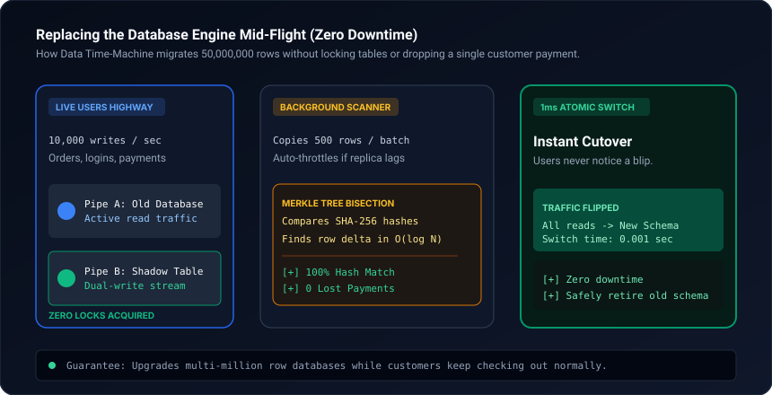

# data-time-machine

Zero-downtime database migration and cryptographic Merkle tree parity engine for AI agents. Alters production tables with millions of rows without locking tables or dropping writes.

[%20Merkle-10b981.svg)](scripts/verify_merkle_sync.py)
[](templates/migration_plan.md)
[](SKILL.md)
[](LICENSE)

<br/>



---

## Why this exists

Running `ALTER TABLE` or adding unique constraints to large tables (>100k rows) acquires exclusive table metadata locks in most relational databases (PostgreSQL, MySQL), leading to queue starvation and outages. Background backfill scripts often introduce silent data drift that standard monitoring fails to catch until billing reconciliations fail weeks later.

`data-time-machine` enforces a 4-phase Expand/Contract protocol with adaptive throttling and builds hierarchical binary Merkle trees to detect and locate any row discrepancy in $O(\log N)$ time.

---

## The 4-Phase Migration Protocol

1. **Phase 1 (Expand):** Add backward-compatible nullable columns or shadow tables. Deploy application writes targeting both old and new columns.
2. **Phase 2 (Idempotent Backfill):** Run chunked background backfill workers (500 rows/batch) throttled by read replica lag (< 80ms).
3. **Phase 3 (Merkle Tree Audit):** Partition primary keys into tree buckets, compute SHA-256 row hashes, and verify root parity. Divergent branches are bisected recursively down to the individual primary key.
4. **Phase 4 (Contract):** Flip active read traffic to the new schema in 1ms. Verify error rates for 24 hours before dropping legacy columns.

---

## Quickstart

Run Merkle tree bisection against a 10,000-record dataset with an injected divergence at row 4,251:

```bash
python scripts/verify_merkle_sync.py --demo
```

---

## Installation

### Claude Code — plugin marketplace (recommended)
```bash
/plugin marketplace add kicode01/data-time-machine
/plugin install data-time-machine@kicode01
```

### Claude Code — manual
```bash
git clone https://github.com/kicode01/data-time-machine.git
cp -r data-time-machine ~/.claude/skills/data-time-machine      # Personal (all projects)
# or per-project:
cp -r data-time-machine .claude/skills/data-time-machine
```

### Claude.ai / Claude Desktop
Run `python tools/package_skill.py` to generate `dist/data-time-machine.zip`, then upload it under **Settings → Capabilities → Skills**.

### Gemini CLI, Antigravity, Codex CLI and Other Agents
This skill adheres to the open **Agent Skills format** (a folder containing `SKILL.md` with standard YAML frontmatter and runnable scripts):

```bash
git clone https://github.com/kicode01/data-time-machine.git
```

| Agent | Personal (All Projects) | Per-Project |
| :--- | :--- | :--- |
| **Gemini CLI / Antigravity** | `~/.gemini/skills/data-time-machine` (or `~/.gemini/config/skills/`) | `.agents/skills/data-time-machine` |
| **Codex CLI** | `~/.codex/skills/data-time-machine` | `.codex/skills/data-time-machine` |
| **Claude Code** | `~/.claude/skills/data-time-machine` | `.claude/skills/data-time-machine` |
| **Cursor / Windsurf / Copilot** | See your agent's skills docs | `.cursorrules` or `skills/data-time-machine` |

```bash
# Gemini CLI & Antigravity
cp -r data-time-machine ~/.gemini/config/skills/data-time-machine

# Codex CLI
cp -r data-time-machine ~/.codex/skills/data-time-machine
```

---

## Author
Created and maintained by **[Kian](https://github.com/kicode01)**.

---

## Repository Structure

* [`SKILL.md`](./SKILL.md): Agent instruction runbook with migration safety gates.
* [`scripts/verify_merkle_sync.py`](./scripts/verify_merkle_sync.py): Hierarchical Merkle tree parity and bisection auditor.
* [`templates/migration_plan.md`](./templates/migration_plan.md): Production cutover and rollback checklist.
* [`tools/package_skill.py`](./tools/package_skill.py): Standalone `.zip` packager for Claude Desktop and releases.
* [`.claude-plugin/plugin.json`](./.claude-plugin/plugin.json): Claude Code plugin marketplace manifest.
* [`assets/architecture.svg`](./assets/architecture.svg): Merkle bisection and pipeline schematic.
